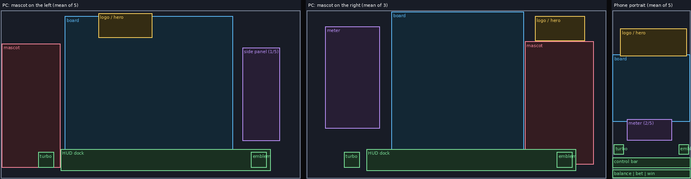
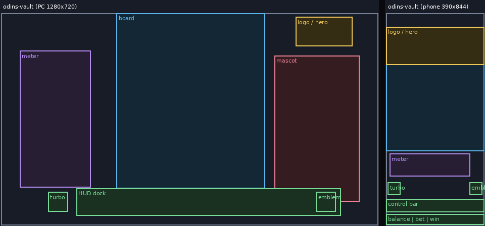

# PC (landscape) layout wireframes, the mascot on one side of the board, and how blocks move to the phone

Companion to `mobile-ui.md` (phone). Evidence: nine gameplay screens of one studio's public demos at 1280x720 (rectangles read off screenshots with a grid, about 1 to 2 percent
error), the same games on a phone (five of them), and a PC and a phone capture of Odin's Vault. Specs: `references/examples/desktop_specs/*.json` and `mobile_specs/*.json`;
drawings: `references/examples/wireframes/*.png` (schematics generated by `scripts/mobile_layout.py wireframe`, original drawings, not screenshots).

## 1. Wireframes



```
PC, mascot on the LEFT (5 of 9)            PC, mascot on the RIGHT (3 of 9)               Phone portrait
+---------------------------------+        +----------------------------------+        +--------------+
| MASCOT   [   BOARD   ] [panel]  |        | [meter]  [   BOARD   ]  LOGO    |        |  LOGO  HERO  |  hero zone 16 to 25%
| (full    [ (centred, ]          |        | (opposite[ (centred,  ] MASCOT  |        |  (mascot bust|
|  body)   [  53% wide)]          |        |  side)   [  53% wide)]  (full   |        |   behind the |
|          [   83% high]          |        |          [   83% high]   body)  |        |   frame top) |
| (logo on the frame top, or      |        | (logo above the mascot)         |        +--------------+
|  above the mascot)              |        |                                  |        | [   BOARD   ]|  full width
|  [turbo] [========= HUD dock ====]       |  [turbo] [======= HUD dock ======]       | [   meter   ]|  directly under
+---------------------------------+        +----------------------------------+        | (turbo)(emb) |  scene band 11 to 13%
 dock x 20 to 90%, y 83 to 96%              dock x 20 to 90%, y 83 to 96%               | [ control bar]|  88 to 94%
                                                                                         | bal | bet | win|  95 to 100%
                                                                                         +--------------+
```

## 2. Measured PC layouts (percent of the 1280x720 viewport)
| Game | Mascot side, x range, y range | Board frame x, y | Opposite side widget (x) | Logo (x, y) |
|---|---|---|---|---|
| Odin's Vault | right, 72 to 95, 20 to 89 | 31 to 70, 0 to 83 | meter panel, 5 to 24 | above the mascot, 78 to 93, 2 to 16 |
| Tome of Hades | right, 74 to 95, 22 to 91 | 27 to 74, 1 to 94 | meter orb and box, 6 to 25 | above the mascot, 74 to 93, 3 to 20 |
| Tome of Hercules | right, 72 to 98, 13 to 96 | 28 to 74, 1 to 94 | meter orb and grid, 8 to 24 | above the mascot, 76 to 92, 6 to 19 |
| Angel of Asgard | left, 2 to 21, 22 to 83 | 21 to 74, 2 to 92 | none | on the frame top, 41 to 59, 1 to 13 |
| Red Strike | left, 0 to 20, 30 to 98 | 21 to 78, 2 to 94 | none | above the mascot, 1 to 15, 2 to 22 |
| High Elf | left, 0 to 20, 9 to 97 | 17 to 84, 2 to 81 | none | on the frame top, 41 to 59, 2 to 16 |
| Four-Leaf Fortune | left, 0 to 19, 16 to 93 | 23 to 77, 2 to 80 | none | on the frame top, 40 to 60, 2 to 15 |
| Tiki Wiki Wild | left, 0 to 20, 22 to 98 | 24 to 76, 9 to 82 | upgrade panel, 81 to 93 | on the frame top, 40 to 60, 2 to 15 |
| Loki's Vault | no mascot | 17 to 84, 9 to 83 | none | top left, 3 to 17, 7 to 23 |

What is constant:
- **The board is centred**: centre at 48 to 51 percent of the width in all nine; width 39 to 67 percent (median 53); height 73 to 93 percent (median 83). The frame may run under the HUD dock.
- **The mascot stands on one side** in a column of 19 to 26 percent of the width (median 20) and 61 to 88 percent of the height (median 69), full body, its feet near the dock line. Five games put it on the left, three on the right, one has none.
- **The opposite side holds a widget** when the game has one (a feature meter panel on the left when the mascot is on the right; an upgrade panel on the right in Tiki Wiki Wild). Without one that side is scenery.
- **The logo** sits above the mascot (Odin's Vault, both Tome games, Red Strike) or centred on the top of the board frame (Angel of Asgard, High Elf, Four-Leaf Fortune, Tiki Wiki Wild).
- **The HUD dock is identical in every game**: a floating turbo or bonus round button at about 13 to 17 percent, then one dock from about 20 to 90 percent of the width and 83 to 96 percent of the height holding menu, balance and win, bet with
  up and down arrows, autoplay, a big spin (about 90 px, 12 percent of the height), and the studio emblem at the right end.
- **The intro and continue screens share one structure** (seen on Castle of Ymir, Waylander's Forge, Wings of Valhalla, Loki's Vault): logo centred at the top (5 to 25 percent), two or three feature call-outs with ribbon labels in the middle (35 to 70 percent),
  a PRESS TO CONTINUE prompt centred at about 87 percent.

## 3. How blocks move from PC to phone (measured on Odin's Vault; checked against Angel of Asgard, Red Strike, Tome of Hades, Loki's Vault)
| PC | Phone portrait |
|---|---|
| Mascot standing beside the board, full body | **above the board, bust only**: the board frame hides the lower body; the spear and companions still show |
| Meter or side panel beside the board | a horizontal bar directly **below** the board |
| Logo above the mascot, or centred on the frame | beside the mascot in the hero zone (top right in Odin's Vault, top left in Red Strike) |
| Board centred, 53 percent of the width | frame at the full width (the reel window stays at about 75 percent of the frame) |
| One HUD dock | control bar (menu, minus, spin, plus, autoplay), a footer of three values, two floating buttons |
| Scenery left and right of the board | scenery below the meter (scene band, 11 to 13 percent) |
| Side panel (Tiki Wiki Wild upgrades) | not measured on a phone |
The side the mascot is on does not matter on a phone: in Red Strike (mascot left) and Odin's Vault (mascot right) the hero ends up in the top zone either way.

## 4. Rules for a PC layout (calibrated on the nine, not a standard)
1. Board frame centred horizontally (50 percent, plus or minus 2), 40 to 67 percent of the width, 73 to 93 percent of the height; it may run under the dock.
2. Mascot on **one** outer side, a column of about 20 percent of the width (19 to 26) and 60 to 90 percent of the height, full body, feet near the dock line; the opposite side holds the feature widget if there is one, otherwise scenery.
3. Logo above the mascot, or centred on the top of the board frame; the logo never overlaps the symbols.
4. HUD dock at 83 to 96 percent of the height, from about 20 to 90 percent of the width; spin of about 12 percent of the height; turbo or bonus floating at the left, studio emblem at the right end of the dock.
5. The mascot's face and the key part of the art stay clear of the dock and of the board frame; the mascot may overlap the board's outer decoration slightly.
6. Design the mascot, the meter and the logo for BOTH arrangements (see `casino-symbol-art/SKILL.md`, phone composition): standing figure on PC, bust on the phone.

## 5. Draw your own wireframes
```sh
python3 skills/stake-casino-game-dev/scripts/mobile_layout.py wireframe specs/mygame_pc.json specs/mygame_phone.json --out wireframe.png     # one panel per spec
python3 skills/stake-casino-game-dev/scripts/mobile_layout.py wireframe skills/stake-casino-game-dev/references/examples/desktop_specs/angel-of-asgard.json --out angel_pc.png
python3 skills/stake-casino-game-dev/scripts/mobile_layout.py wireframe specs/*.json --average --title "my group" --out mean.png                    # mean layout of a group
```
A spec lists rectangles (`logo`, `mascot`, `board`, `meter`, `panel`, `scene`, `float_l`, `float_r`, `hud`, `controls`, `balance`) in screenshot pixels with the viewport and image size; read the rectangles with
`mobile_layout.py grid shot.png --out grid.png`. The `report` rules in `mobile_layout.py` are for the phone layout only; there is no automatic PC check.

## 6. Limits
Nine games of one studio; rectangles are read by eye (grid of 10 percent); three of the twelve desktop captures were intro screens and are used only for the intro structure; the PC to phone mapping was
checked on five games. Other studios place mascots and HUDs differently. Win animations, popups and bonus screens were not laid out here.
